  
  
  
  
  

 

### About

I build things nobody asked for, and now and then I finish one. Mostly Python and TypeScript: command-line tools, GitHub Actions, small real-time apps, and browser games that make noise.

My best work starts as a side quest. Case in point: I needed a banner for this page and ended up writing a ray tracer for curved spacetime.

 

### Selected work

| Project | What it does | Built with |
| :-- | :-- | :-- |
| [**AI-PR-reviewer**](https://github.com/KushalxYadav/AI-PR-reviewer) | A GitHub Action that has Gemini read every pull request for bugs and security issues, then posts a severity-ranked review. One workflow file, one secret. | TypeScript · GitHub Actions · Gemini API |
| [**Anything-into-binary**](https://github.com/KushalxYadav/Anything-into-binary) | `binconv` turns text, web articles or any file into bits, hex or base64, and back again. UTF-8 safe, Hindi and emoji included. | Python · trafilatura |
| [**1am-void**](https://github.com/KushalxYadav/1am-void) | An anonymous real-time chat that only opens between 1 and 5 AM IST. The rest of the day, the void is closed. | FastAPI · WebSockets · SQLite · PWA |
| [**The-Rabbit-Hole**](https://github.com/KushalxYadav/The-Rabbit-Hole) | A six-level sound puzzle game. Headphones on: the clues are spatial. | Canvas · Web Audio · zero dependencies |

 

### Stack

| Area | Tools |
| :-- | :-- |
| **Languages** | Python, TypeScript, JavaScript, HTML & CSS |
| **Backend** | FastAPI, Node.js, WebSockets, SQLite |
| **Frontend** | Canvas 2D, Web Audio API, Progressive Web Apps |
| **AI** | Gemini API |
| **Graphics & numerics** | NumPy, Numba, SciPy |
| **Tooling** | Git, GitHub Actions, Vitest, Bun |

 

  The banner is a pulsar — a 10 km neutron star — ray-traced from scratch in Python through its own curved spacetime, then put through a simulated telescope. No stock art, no image generator — <a href="https://github.com/KushalxYadav/KushalxYadav/tree/main/scripts">see how</a>.

